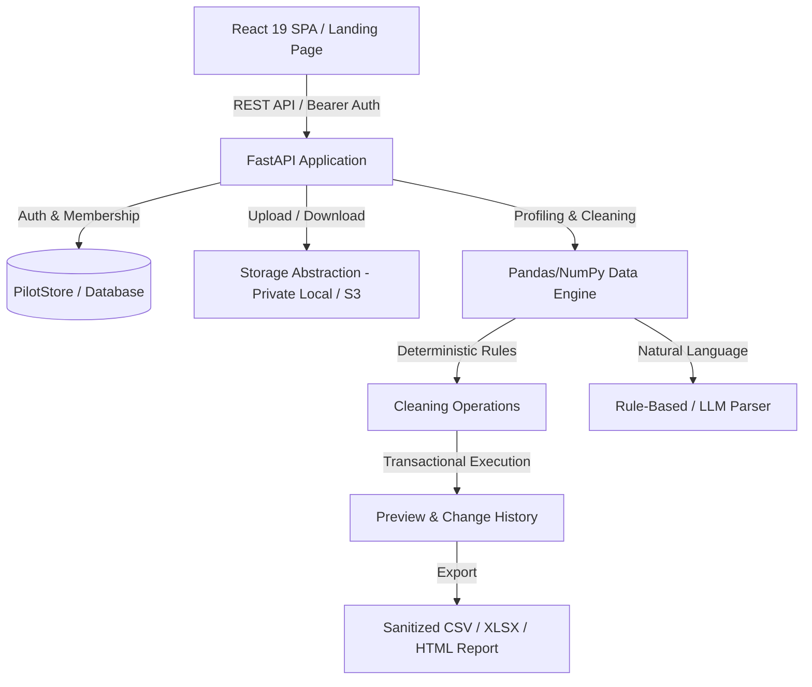

# BUILDORA Implementation & Transformation Plan

**Target:** Enterprise-Grade Data Cleaning & Business Reporting SaaS  
**Architecture:** FastAPI (Backend) + React 19/Vite (Frontend) + SQLite (Dev) / PostgreSQL (Prod) + Private File Storage Abstraction  
**Core Principles:** Deterministic Data Engine, Human-in-the-Loop Safe Execution, Zero Unverified AI Claims, Multi-Tenant Data Isolation

---

## 1. Architectural Strategy

The transformed platform implements a dual-revenue business model:
1. **Self-Service SaaS:** Upload messy spreadsheets (CSV, Excel/XLSX), view instant automated data-quality audits with transparent quality scores, preview and apply deterministic cleaning operations, run natural-language instructions, and export cleaned files and executive HTML quality reports.
2. **Done-for-You Data Service:** Integrated customer acquisition workflow allowing SMBs and agencies to request custom recurring cleaning and analytics projects without exposing sensitive data prematurely.

---

## 2. Phase-by-Phase Roadmap

### Phase 1: Storage Layer & Sample Dataset
- Implement `backend/app/services/storage.py` supporting:
  - Private storage folder outside public web root (`storage/datasets/`).
  - Strict validation: magic numbers/file signature checks, extension matching, MIME type verification, size enforcement (max 25MB default).
  - Path traversal defense (`os.path.basename`, sanitized UUID storage keys).
  - CSV Formula Injection defense: sanitizing export strings starting with `=`, `+`, `-`, `@`, `\t`, `\r`.
- Create synthetic benchmark dataset `sample_data/messy_sales.csv`:
  - 120+ rows of realistic multi-currency, messy retail transactions.
  - Injected anomalies: leading/trailing whitespace, missing customer emails, negative and extreme price outliers, mixed date formats (`DD/MM/YYYY`, `YYYY-MM-DD`, `MM-DD-YYYY`), inconsistent category casing (`tech`, `Technology`, `TECH`), duplicate transaction IDs, formula injection attempts.

### Phase 2: Core Data Cleaning & Profiling Engine
- Implement `backend/app/services/data_engine.py`:
  - **Data Profiler:**
    - Dataset dimensions (rows, columns, total memory).
    - Missing values count and percentage per column.
    - Exact duplicate rows and duplicate identifier columns.
    - Leading/trailing whitespace counts.
    - Type inconsistencies (numeric stored as text, e.g. `$1,420.50`).
    - Date parsing feasibility and format diversity.
    - Constant and near-constant columns.
    - Inconsistent categorical casing.
    - Outlier detection via Tukey's IQR rule (1.5x IQR) and Z-scores.
  - **Explainable Quality Score (0–100):**
    - Base score = 100.
    - Deductions: Missing values penalty (up to 30 pts normalized), duplicate rows penalty (up to 20 pts), type inconsistency penalty (up to 20 pts), category and whitespace anomalies (up to 15 pts), severe outliers (up to 15 pts).
    - Transparent deduction log with reasons and affected column breakdown.
  - **Deterministic Cleaning Operations:**
    - `trim_whitespace`: Trims all string columns.
    - `drop_duplicates`: Removes exact duplicate rows or duplicates on specific primary keys.
    - `fill_missing`: Imputes missing values via strategy (`constant`, `mean`, `median`, `mode`, `ffill`, `bfill`).
    - `convert_numeric`: Strips currency symbols (`$`, `€`, `₹`, `,`), parses floats/ints.
    - `convert_dates`: Parses inconsistent date formats into standard ISO-8601 (`YYYY-MM-DD`).
    - `normalize_categories`: Standardizes casing (`title`, `lower`, `upper`) and trims whitespace.
    - `drop_missing_rows`: Drops rows where critical columns have nulls.
    - `rename_column`: Safely renames columns with validation.
    - `filter_rows`: Applies condition-based filtering.
  - **Safe Execution & Transactional Rollback:**
    - Every operation generates a before/after preview (first 10 modified rows) without mutating original files.
    - User confirms operation -> operation applied to working version -> recorded in immutable change history with rollback pointer.
  - **Natural-Language Cleaning Assistant:**
    - Parses natural-language intents into structured operation payloads (`operation_type`, `params`).
    - Supported commands: "Trim whitespace", "Remove duplicates", "Fill missing [col] with [val]", "Convert [col] to numeric", "Standardize [col] casing".
    - Deterministic rule parser with zero paid API requirement, plus optional LLM bridge when configured.

### Phase 3: Database & Tenant Isolation
- Enhance `backend/app/database/pilot_store.py`:
  - New tables: `datasets`, `cleaning_operations`, `data_reports`, `saved_workflows`, `service_inquiries`.
  - Strict foreign keys and cascading deletes.
  - Row-level scoping: every query filters by `workspace_id` and checks user role.
  - Cross-tenant access attempts return HTTP 403/404.

### Phase 4: API Endpoints & Routes
- Implement `backend/app/api/data_routes.py` mounted at `/api/v1/datasets`:
  - `POST /upload`: Multipart file upload, magic byte check, metadata extraction, baseline profiling.
  - `GET /sample-demo`: Loads `messy_sales.csv` for unauthenticated landing page visitors.
  - `GET /{dataset_id}/preview`: Paginated row preview with column profiling.
  - `GET /{dataset_id}/profile`: Detailed data-quality report and score.
  - `POST /{dataset_id}/propose`: Generates before/after diff for an operation.
  - `POST /{dataset_id}/apply`: Commits the operation, updates working version, logs history.
  - `POST /{dataset_id}/undo`: Reverts the last operation.
  - `POST /{dataset_id}/reset`: Reverts dataset to original uploaded state.
  - `POST /{dataset_id}/parse-nl`: Translates user text command into structured operation.
  - `GET /{dataset_id}/analytics`: Aggregated summaries (totals, averages, group-bys, distributions).
  - `GET /{dataset_id}/export/{format}`: Downloads cleaned CSV or XLSX with formula protection.
  - `GET /{dataset_id}/report/html`: Generates standalone, printable HTML executive audit report.
  - `POST /service-inquiry`: Captures inbound agency/service requests with email validation.
  - `GET /service-inquiries`: Internal admin view for service leads.

### Phase 5: Frontend UI/UX Overhaul
- **Public Website (`LandingPageView.jsx`):**
  - High-converting headline: "Clean messy spreadsheets, understand your data quality, and turn business data into useful reports."
  - Interactive "Try Sample Data" playground running live against backend API with zero signup barrier.
  - Real before-and-after spreadsheet preview.
  - Transparent pricing tiers (Free, Starter, Pro, Business Service).
  - Integrated Service Inquiry Form for custom agency projects.
  - Legal, Privacy, and Security information sections.
- **Data Cleaning Workspace (`DataWorkspaceView.jsx`):**
  - Drag-and-drop file uploader with live validation.
  - Data Quality Gauge & Breakdown cards.
  - Paginated interactive data table with sticky headers.
  - Cleaning Command Bar with Natural Language input + 1-click Quick Clean buttons.
  - Operation Confirmation Modal with live row diff.
  - Applied Operations Timeline with Undo/Reset controls.
  - Export Bar: CSV, XLSX, Executive HTML Report.
  - Visual analytics charts for column distributions and grouped aggregations.
- **Service Inquiry Admin Portal:**
  - Lead tracker for founders (Status: New, Contacted, Proposal Sent, Won, Lost).

### Phase 6: Automated Testing & Verification
- Unit & integration tests in `backend/tests/`:
  - `test_data_engine.py`: Profiler rules, quality score formula, each cleaning operation, formula injection defense.
  - `test_storage.py`: Path traversal, size limit, MIME/magic bytes validation.
  - `test_auth_isolation.py`: Cross-user data isolation, role enforcement, token expiration.
  - `test_data_routes.py`: Upload, preview, propose, apply, undo, export, sample demo flow.
  - `test_service_inquiry.py`: Inquiry validation and admin authorization.
- Execute full test suite via `pytest` and record live outputs.

### Phase 7: Business & Marketing Documentation
- Generate editable go-to-market resources in `docs/`:
  - `docs/CUSTOMER_ACQUISITION_PLAN.md`
  - `docs/OUTREACH_TEMPLATES.md`
  - `docs/FREELANCE_SERVICE_PACKAGES.md`
  - `docs/PRODUCT_HUNT_LAUNCH_PLAN.md`
  - `docs/COMPETITOR_RESEARCH_TEMPLATE.md`
