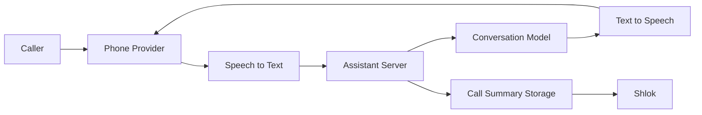

# Shlok AI Phone Assistant

Starter project for a voice-based phone assistant that answers calls when Shlok is unavailable.

The current MVP runs locally as a call simulator. It models the assistant behavior from `plan.txt`, keeps replies short, collects caller details, protects sensitive information, and generates an internal call summary.

## Run Locally

```powershell
npm start
```

Type caller messages into the terminal. Use `exit` to end the simulated call and print the internal summary.

## Run As A Phone Bot

Install dependencies:

```powershell
npm install
```

Set your OpenAI API key:

```powershell
$env:OPENAI_API_KEY="sk-your-openai-api-key"
```

Start the phone server:

```powershell
npm run phone
```

Expose the local server with ngrok:

```powershell
ngrok http 3000
```

Copy the HTTPS forwarding URL from ngrok, then restart the phone server with:

```powershell
$env:PUBLIC_URL="https://your-ngrok-url"
npm run phone
```

In Twilio, set your phone number's incoming voice webhook to:

```text
https://your-ngrok-url/voice
```

Use HTTP `POST`. When someone calls the Twilio number, Twilio connects the call audio to `wss://your-ngrok-url/media`, and this app bridges the audio to OpenAI Realtime.

## Test

```powershell
npm test
```

## What Is Implemented

- Natural opening greeting for incoming calls.
- Message collection for callback requests.
- Meeting request intake without confirming availability.
- Business inquiry intake for projects, collaboration, freelancing, and partnerships.
- Basic technical-question handling for Shlok's known interests.
- Emergency escalation wording.
- Sensitive-information refusal.
- Internal call summary generation.

## Suggested Real Phone Architecture



To make this answer real calls, connect this project to:

- A phone provider such as Twilio, Exotel, or Plivo.
- Speech-to-text for live caller audio.
- A conversation model using the rules in `src/assistantProfile.js`.
- Text-to-speech for spoken assistant replies.
- A database, sheet, or notification system for call summaries.

This project includes the Twilio Media Streams bridge in `src/phoneServer.js`.

## Important Production Notes

- Do not hard-code API keys or phone credentials.
- Store call recordings only with proper consent and local legal compliance.
- Keep summaries private because they may contain personal caller information.
- Add human review for urgent, sensitive, or uncertain calls.
